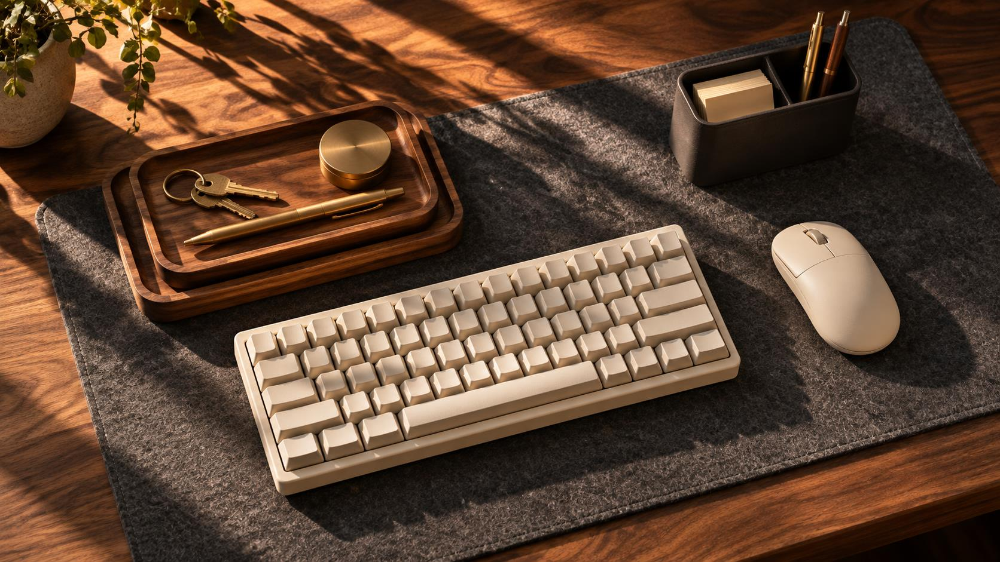

# Desk Order

A bilingual desk accessories storefront for the US market, built around a Shopify theme and a runnable local commerce demo.



## Run locally

Requires Python 3.8 or later. The demo uses the Python standard library and SQLite.

```sh
python store/launch.py
```

The launcher opens the English storefront in your browser. Switch to Chinese from the navigation. Choose a product to try checkout, then open the merchant dashboard in the footer to fulfill the order or process a return. Payments and shipping are simulated.

## Project

| Directory | Contents |
| --- | --- |
| [desk-order/](desk-order/) | Shopify Liquid theme based on Dawn, with configurable storefront sections and a desk mat size guide |
| [store/](store/) | Local storefront, product photography concepts, checkout and order management |
| [catalog/](catalog/) | Six draft products with US pricing and Shopify import fields |

## Shopify setup

Set the store currency to USD before importing [the product catalog](catalog/products.csv). Upload the theme by archiving the **contents** of the `desk-order` directory with `layout/`, `templates/` and `assets/` at the archive root. Enable English and Simplified Chinese in Shopify, then add product translations and configure shipping for your market. The theme inherits the [Dawn license](desk-order/LICENSE.md).

## Verification

```sh
python store/verify.py
```

The checks run against a temporary database and cover catalog routes, language alternates, product metadata, checkout, inventory and order fulfillment.
